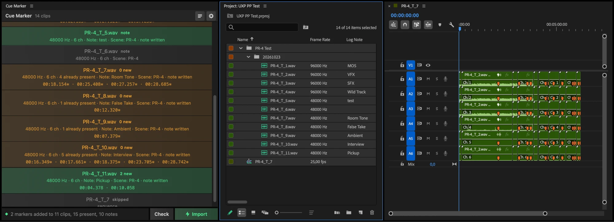
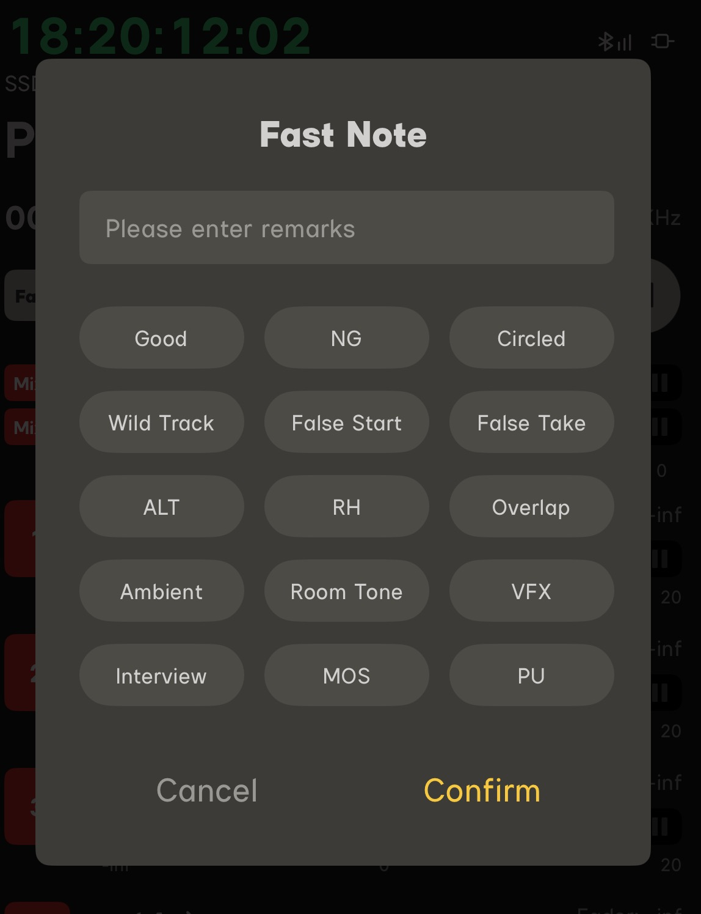
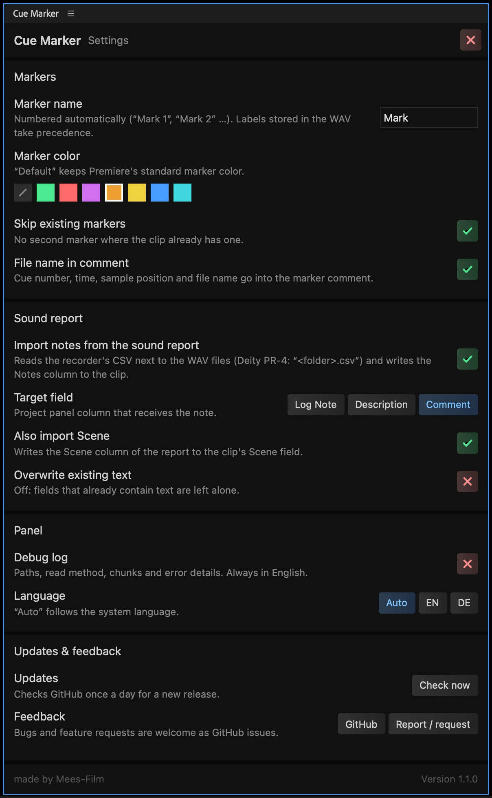

# Cue Marker – import Deity PR-4 markers into Premiere Pro

  

Free Premiere Pro panel that reads the **MARK points of the Deity PR-4** (and any other recorder that writes WAV cue points) and adds them as **clip markers** to your audio clips. It also reads the **notes from the PR-4 sound report** (“Wild Track”, “False Take” …) and shows them in the Project panel as **Log Note**, **Description** or **Comment**.

Premiere ignores the cue chunk in WAV files, so PR-4 markers never show up after import. This plugin fixes that: select the clips, press Import, done. The WAV files are never modified.

### [**Download the latest release**](https://github.com/Maxiklaxi/Cue-Marker/releases/latest)

*Left: the panel after Import. Middle: the sound-report notes in the Log Note column. Right: the PR-4 markers on the clips in the timeline.*

## Install

1. Download the `.ccx` from the [latest release](https://github.com/Maxiklaxi/Cue-Marker/releases/latest) and double-click it. Creative Cloud installs it.
2. In Premiere Pro: *Window → UXP Plugins → Cue Marker*.

Requires Premiere Pro 26.2 or newer. On first start the plugin asks for file access (to read the WAVs) and for network access to `api.github.com` (update check only).

## Use

1. Select your PR-4 clips in the **Project panel**.
2. **Check** lists the markers it found in each file.
3. **Import** adds them as clip markers. Existing markers at the same position are skipped, so you can run it again safely.

Markers are named “Mark 1”, “Mark 2” … (the PR-4 stores no names). Prefix, marker color and language (English/German) can be changed in the settings (⚙).

**Notes from the SOUND REPORT:** the PR-4 saves the notes you pick on the recorder (“Wild Track”, “False Take”, “Room Tone” …) and the scene name in a CSV next to the WAV files, not in the WAV itself. If that CSV is in the folder, Import also writes the note to the clip and the scene to the clip's **Scene** field. You choose in the settings whether the note goes to **Log Note**, **Description** or **Comment**; show that column in the Project panel via *Metadata Display* and you see the notes next to your clips, as in the screenshot above. Existing text is kept unless you enable overwriting.

*Where the notes come from: the “Fast Note” dialog in the Deity Sidus Audio app (also available on the PR-4 itself). Presets like Wild Track, False Take or Room Tone and free-text remarks end up in the sound report, and Cue Marker brings them into Premiere.*

## Settings

## Works with

- **Deity PR-4** – verified with real recordings (RF64, 32-bit float, 6 channels, 48/96 kHz).
- Any WAV with a standard `cue ` chunk: Zoom, Sound Devices, Tascam, Audacity exports and others should work the same way. If yours doesn't, [open an issue](https://github.com/Maxiklaxi/Cue-Marker/issues/new/choose) with a short sample file.

## Feedback

Bugs and feature requests are welcome as [GitHub issues](https://github.com/Maxiklaxi/Cue-Marker/issues/new/choose). Ideas and questions go to [Discussions](https://github.com/Maxiklaxi/Cue-Marker/discussions).

## About

This plugin is **fully vibe-coded**: code, parser, docs and design were written by an AI coding assistant (Claude Code) in conversation with the maintainer, who tests it against real PR-4 recordings in Premiere Pro.

**Credits:** the panel design follows [OpenCurve](https://github.com/fayewave/OpenCurve) by [faye](https://github.com/fayewave). No code was taken from it. API usage is based on Adobe's [uxp-premiere-pro-samples](https://github.com/AdobeDocs/uxp-premiere-pro-samples).

**For developers:** `node _test_cues.js index.js file.wav` tests the parser without Premiere, `./build-ccx.sh` builds the package. German manual: [ANLEITUNG.md](ANLEITUNG.md).

[MIT](LICENSE) © Mees. Film
