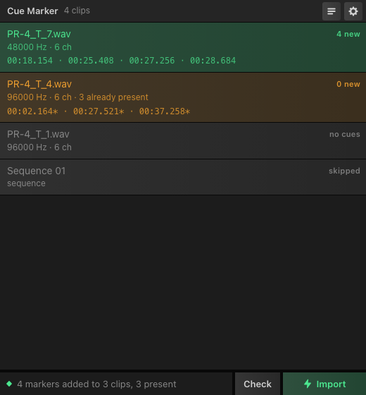
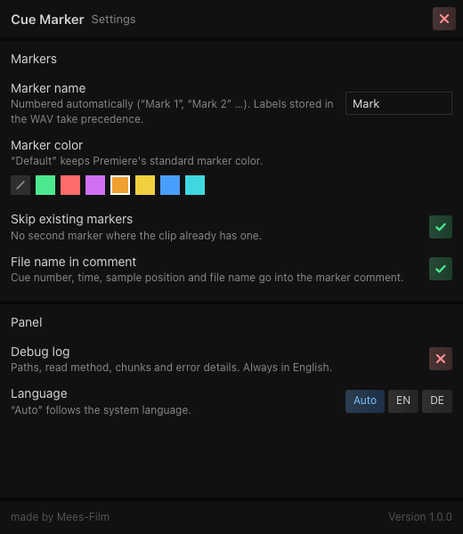

# Cue Marker – Premiere Pro UXP plugin

Imports the cue points stored in WAV files as **clip markers** in Adobe Premiere Pro.

Field recorders such as the **Deity PR-4** write their MARK button presses into the WAV file's `cue ` chunk. Premiere Pro ignores that chunk for audio files (it only picks up XMP markers), so the markers never show up after import. This panel reads them straight from the WAV and adds them to the selected project items. The WAV files are only read, never modified.



<details><summary>Settings view</summary>



</details>

## Features

- Reads `cue ` chunks from **RIFF**, **RF64** and **BW64** WAV files (the PR-4 writes RF64 even for small files).
- Reads only the chunk headers and the small metadata chunks. A 360 MB take costs a few hundred bytes of I/O, so checking a whole day of recordings takes a moment.
- Uses `labl` names and `note` texts from the `LIST/adtl` chunk when a file has them; otherwise markers are numbered (“Mark 1”, “Mark 2” …).
- **Check** mode lists the cue points per clip without touching the project.
- **Import** adds the markers as comment markers, one undo step per clip.
- Optional marker color (green, red, purple, orange, yellow, blue, cyan) or Premiere's default.
- Skips positions that already carry a clip marker (±2 ms), so you can re-run it safely.
- Bins, sequences, offline clips and non-WAV media in the selection are skipped and listed with the reason.
- English and German UI, automatically chosen from the system language and switchable in the settings.
- Flat, tool-like panel in the style of other Premiere UXP panels such as OpenCurve: clip rows tinted by result, status strip and Go button at the bottom, settings as a full-panel view. Settings are also reachable from the panel's flyout menu (≡).

## Works with

Any WAV file that contains a standard `cue ` chunk. Verified with:

| Recorder / source | Format | Status |
| --- | --- | --- |
| Deity PR-4 | RF64, 32-bit float, 6 channels, 48/96 kHz | verified with real recordings |
| Classic RIFF WAV with `labl`/`note` entries (e.g. Audacity label exports) | RIFF | verified with a generated test file |

Recorders from Zoom, Sound Devices, Tascam and others write the same chunk and should work the same way. Please open an issue with a short sample file if yours doesn't.

## Requirements

- Adobe Premiere Pro **26.2 or newer** (UXP Premiere API). Developed on 26.5.
- For loading the plugin from source: [Adobe UXP Developer Tools](https://developer.adobe.com/photoshop/uxp/2022/guides/devtool/).

## Installation (from source)

1. Download or clone this repository.
2. Premiere Pro: *Settings → Plugins → Enable developer mode*, then restart Premiere.
3. UXP Developer Tools: *Add Plugin* → select `manifest.json` from this folder → *Load*.
4. On first load UXP asks for permission to access your files (`fullAccess`). The plugin needs it to read the WAV files that live outside the plugin folder. It never writes to them.
5. The panel appears as *Cue Marker* (otherwise: *Window → UXP Plugins*).

## Usage

1. Select the audio clips in the **Project panel** (multiple selection is fine; bins are skipped, not searched).
2. Click **Check** in the bottom bar. The panel lists every clip with its cue count and times; the status strip sums it up.
3. Click **Import**. Rows turn green for clips that received markers. The markers appear in the Source Monitor and in the Markers panel when the clip is open there.

Times shown as `mm:ss.mmm`; a trailing `*` marks positions that already had a marker.

## Settings (⚙ or flyout menu)

| Setting | Default | Meaning |
| --- | --- | --- |
| Marker name | `Mark` | Prefix for numbered markers. Labels stored in the WAV take precedence. |
| Marker color | Default | One of Premiere's marker colors, or Default to leave it alone. The color is applied in a second transaction right after the markers are added, so it shows up as a separate undo step. |
| Skip existing markers | on | No second marker within 2 ms of an existing one. |
| File name in comment | on | Marker comment contains cue number, time, sample position and file name. |
| Debug log | off | Shows file paths, the read method that worked, chunk layout and error details below the list. Also toggled by the list icon in the toolbar and from the flyout menu. Turn it on before reporting a bug and use the copy icon. |
| Language | Auto | English / German. |

## How it works

1. `ProjectUtils.getSelection()` gives the selected project items; each is cast to a `ClipProjectItem` and its `getMediaFilePath()` is read.
2. The WAV is opened with UXP's `fs` module and walked chunk by chunk. `ds64` is used for the data size of RF64 files, so the parser can jump over the audio data to the `cue ` chunk at the end of the file.
3. Each cue's `dwSampleOffset` divided by the sample rate from `fmt ` gives the marker time in seconds.
4. `Markers.getMarkers(clipProjectItem)` → `createAddMarkerAction(...)`, executed inside `project.lockedAccess()` + `project.executeTransaction()`.
5. With a color chosen, the new markers are looked up again by time and name and colored with `createSetColorByIndexAction(Constants.MarkerColor.<COLOR>)` in a second transaction. White is not offered because the API does not document it.

Marker times are relative to the start of the media (0 s), independent of the file's BWF start timecode.

## Development

The parser can be tested without Premiere:

```sh
node _test_cues.js index.js /path/to/recording.wav [more.wav …]
```

It prints format, sample rate, cue positions and how many bytes were actually read. The expected sample positions of the bundled reference recording `PR-4_T_7.wav` are hard-coded in the script, so it doubles as a regression test.

Files:

| File | Purpose |
| --- | --- |
| `manifest.json` | UXP manifest (v5), Premiere Pro host, `fullAccess` file permission |
| `index.html` / `styles.css` | Panel UI (plain HTML/CSS, Flexbox only, no framework). `styles.css` carries the look and can be reused for other panels. |
| `index.js` | Strings, UI, WAV parser, file access, Premiere integration |
| `_test_cues.js` | Node test for the parser |
| `ANLEITUNG.md` | German manual |

## Limitations

- Clip markers only. Sequence markers for clips already placed in a timeline are not created; add the clip markers first and they travel with the clip.
- Cue points inside bins are not collected recursively; select the clips themselves.
- Markers are placed by sample position. If a clip's audio was interpreted at a different sample rate in Premiere, the markers follow the interpreted rate.

## Contributing

Issues and pull requests are welcome. For recorder compatibility reports, please attach the output of `_test_cues.js` or a trimmed sample file (a few seconds with a cue point is enough).

## License

[MIT](LICENSE) © Mees. Film

---

**Deutsch:** Das Plugin liest die MARK-Punkte aus WAV-Dateien (z. B. vom Deity PR-4) und legt sie als Clip-Marker in Premiere Pro an. Die Oberfläche ist zweisprachig. Eine deutsche Anleitung steht in [ANLEITUNG.md](ANLEITUNG.md).
